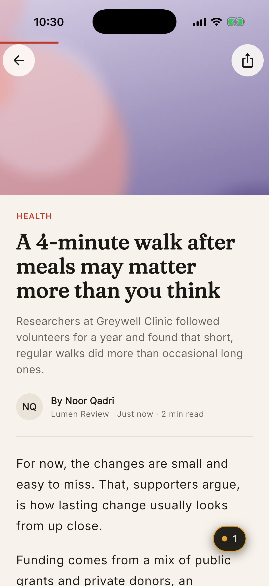

# Brief

A calm, editorial news reader built for **Episode 4** of a Flutter performance series:
*"Pull-to-refresh + initState: the duplicate fetch in almost every app."*

It's a real-feeling app (serif headlines, warm paper theme, dark mode, Hero transitions,
shimmer skeletons) with one very common bug inside, and a **Lab** switch to compare it with
the fix. [waste_lens](https://pub.dev/packages/waste_lens) and
[waste_lens_dio](https://pub.dev/packages/waste_lens_dio) measure the difference.

| Today (light) | Today (dark) | Story |
|---|---|---|
|  |  |  |

```
server/    Deterministic mock news server (Dart + shelf), with generated cover art
app/       Flutter app: Bloc + bloc_concurrency, get_it, Dio, google_fonts, waste_lens
episodes/  The episode guide: the bug, the fix, the numbers, the script
docs/      Screenshots
```

## Run it

### 1. Server

```bash
cd server
dart pub get
dart run bin/server.dart
```

Options (defaults shown):

```bash
dart run bin/server.dart --port 8081 --latency-ms 700 --jitter-ms 0 --seed 42
```

- `--latency-ms`: delay on every `/feed` response, so the "spinner that lies" is easy to see.
- `--jitter-ms`: extra random delay per response, so responses can arrive out of order.
- `--log-images`: also log image requests (quiet by default).

It binds `0.0.0.0`, so a phone on the same Wi-Fi can reach it.

### 2. App

```bash
cd app
flutter pub get
flutter run
```

The app uses `localhost` on iOS and `10.0.2.2` on Android. On a physical phone:

```bash
flutter run --dart-define=API_HOST=$(ipconfig getifaddr en0)
```

Run in **debug** mode: waste_lens turns itself off in release builds.

### 3. The Lab

Tap the **Lab** pill (top-right) to switch the feed between **With bug** and **With fix**,
and to show or hide the debug strip (`requests: N · redundant: M` for `/feed`).

### Checks

```bash
cd server && dart analyze
cd app && flutter analyze && flutter test
```

## Server API

| Method | Endpoint | Returns |
|---|---|---|
| GET | `/feed?category=top&page=1` | `{category, page, hasMore, stories}`. 12 stories per page. Categories: `top`, `tech`, `markets`, `health`, `science`, `culture`. Each page-1 request publishes 1–3 new stories first. |
| GET | `/images/{id}.jpg` | Generated abstract cover art, 1200×800 JPEG (~30 KB), deterministic per id |
| GET | `/health` | `{ok: true}` |

A story: `{id, title, summary, body[], category, source, author, publishedAt, readMinutes, imageUrl}`.
Every source, person and place is fictional.

The server log marks duplicate requests:

```
[#10] GET /feed?category=top&page=1
[#11] GET /feed?category=top&page=1   <-- x2 in 2s
       [#10] 200 after 700ms  +1 new
```

## The episode

[EP04: Pull-to-refresh + initState](episodes/EP04_pull_to_refresh_initstate.md)
