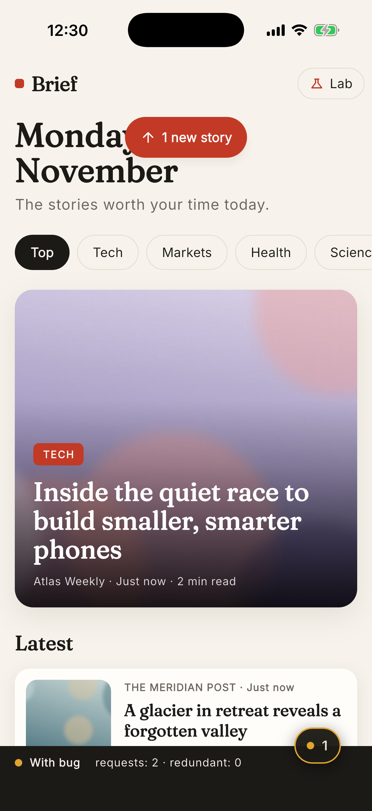
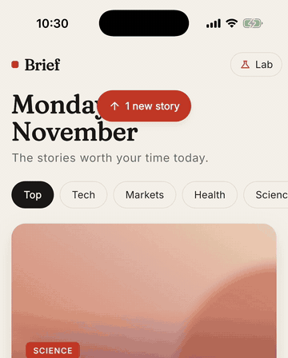
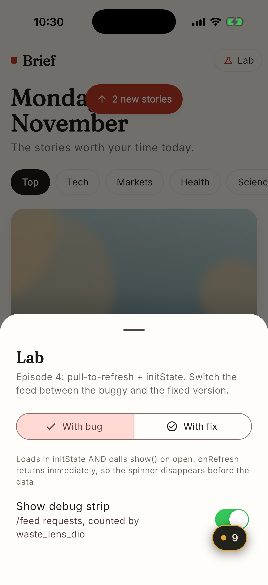
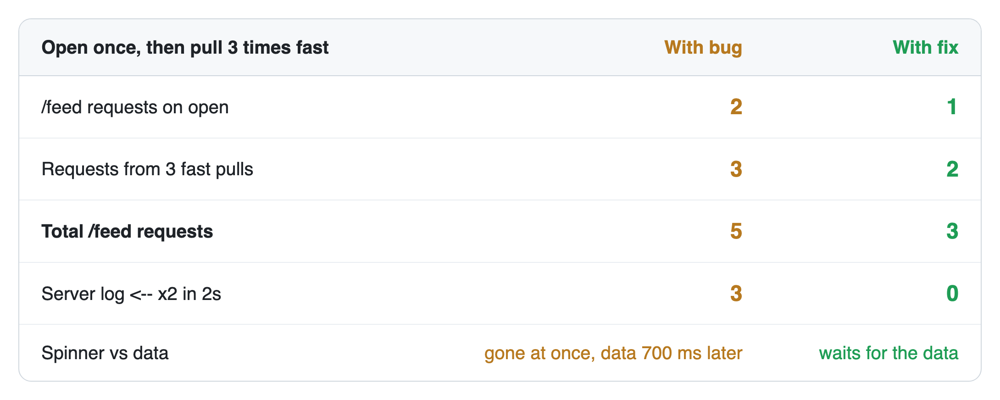

# Your pull-to-refresh is lying to your users

*Episode 4 of a series on finding wasted work in Flutter apps, with numbers instead of guesses.*

<p align="center">
  
  <br>
  <em>Brief. Notice the “1 new story” pill the moment it opens. That’s the bug.</em>
</p>

I built a small news reader called **Brief**: serif headlines, a warm paper theme, pull to refresh. It looks finished.

Then I watched my server log while opening it. One open, **two identical requests**.

Then I pulled to refresh three times, because the spinner vanished so fast I wasn’t sure it had worked. **Five requests** in total, three of them flagged by the server as duplicates.

This pattern is in almost every app I’ve reviewed, and it comes from two perfectly reasonable ideas that don’t know about each other.


*The server log. Every `<-- x2 in 2s` is the same request arriving twice within two seconds.*

---

## Bug 1: two loads every time the screen opens

**Idea one:** load the feed in `initState`.

**Idea two:** users should see a spinner while it loads, so call `show()` on the `RefreshIndicator` after the first frame.

```dart
@override
void initState() {
  super.initState();
  // 1. Load on open: request #1.
  _bloc = FeedBloc(getIt<FeedRepository>())..add(const FeedStarted());
  // 2. ...and also show the spinner on open.
  WidgetsBinding.instance.addPostFrameCallback(
    (_) => _refreshKey.currentState?.show(),
  );
}
```

Here’s the catch: `RefreshIndicator.show()` doesn’t just *draw* the spinner. It runs the same `onRefresh` callback a pull would.

So the screen loads the feed, and a moment later loads it again, while the first request is still in flight. In Brief you can even see it: the second response contains a story the first one didn’t, so a “new story” pill appears the instant the app opens.

## Bug 2: the spinner that lies

```dart
onRefresh: () async => _bloc.add(const FeedRefreshed()),
```

`RefreshIndicator` keeps spinning until the `Future` returned by `onRefresh` completes. But `bloc.add()` returns immediately, so this `Future` completes immediately.

The spinner disappears long before the 700 ms response arrives. To the user, nothing happened. So they pull again. And again. **Every pull is another request.**

<p align="center">
  
  <br>
  <em>First with the bug: the spinner is gone at once. Then with the fix: it waits for the data.</em>
</p>

---

## The fix: three small changes


*Same file, same shape. Only the highlighted lines change.*

### 1. One trigger on open

The bloc loads once, when it’s created. As a safety net, `droppable()` from `bloc_concurrency` ignores extra refresh events while one is already running.

```dart
_bloc = FeedBloc(getIt<FeedRepository>(), dropDuplicateRefreshes: true)
  ..add(const FeedStarted());
```

### 2. No `show()` on open

The shimmer skeleton already says “loading”. A second loading indicator added nothing except a second request.

### 3. An `onRefresh` that tells the truth

Return a `Future` that completes when the data has actually arrived:

```dart
onRefresh: () async {
  final done = _bloc.stream.firstWhere((s) => s.settled);
  _bloc.add(const FeedRefreshed());
  await done;
},
```

Now the spinner stays up exactly as long as the request does. And while it’s up, `RefreshIndicator` itself refuses another pull, so pulls can’t stack.


*The first two changes fix the bugs. `droppable()` is a safety net, not the fix.*

I typed this fix into the running app and hot restarted. (A hot *reload* isn’t enough here: `initState` has to run again.) The very next open sent **one** request.

---

## The numbers

To compare fairly, Brief has a small **Lab** sheet that switches the feed between the buggy and the fixed version, against the same server.

<p align="center">
  
  <br>
  <em>The Lab: With bug or With fix, plus a debug strip that counts requests.</em>
</p>

The test: open the feed once, then pull to refresh three times as fast as the indicator allows. Same server, same 700 ms response time.


*Five requests became three, and the server flagged zero duplicates.*

The debug strip counts the same requests from inside the app, using [waste_lens_dio](https://pub.dev/packages/waste_lens_dio)’s `RedundantCallInterceptor`:

<p align="center">
  
</p>

### A note on “redundant”

waste_lens_dio flags a request when an identical one has *finished* within the last two seconds. Two consequences:

- It **can’t** see the two overlapping requests on open, because neither has finished when the other starts. The server log catches those.
- The fix’s `redundant: 1` is a real pull that started within two seconds of the previous load finishing. A time window can’t tell a duplicate from a user who genuinely wants fresh news.

That’s why the server log is the headline number: **3 duplicates with the bug, 0 with the fix.**

---

## Three questions you’ll probably ask

**Why not just disable the indicator while loading?**

`RefreshIndicator` already refuses new pulls while its `Future` is pending. The bug isn’t that it allowed the pull. It’s that we told it the refresh finished after 0 ms. Return the real `Future` and it handles the rest.

**Isn’t `droppable()` enough on its own?**

No. It only drops events that arrive *while a handler is still running*. With the lying `onRefresh`, users pull again after the spinner is gone, often after the previous load has finished, so nothing gets dropped. It also does nothing about the `show()`-on-open duplicate. Keep it as a safety net.

**What about FutureBuilder?**

Same trap, different shape. `FutureBuilder(future: repo.load())` inside `build()` starts a new request on every rebuild, and `onRefresh: () async => setState(...)` lies in exactly the same way. Create the `Future` once, keep it in state, and return that same `Future` from `onRefresh`.

---

## The rule

> **One trigger on open, and an `onRefresh` that tells the truth.**

`droppable()` is a good safety net. But the real fix is making the spinner mean what it says.

---

*Code: [github.com/poojadev/brief](https://github.com/poojadev/brief)*
*waste_lens: [pub.dev/packages/waste_lens](https://pub.dev/packages/waste_lens) · waste_lens_dio: [pub.dev/packages/waste_lens_dio](https://pub.dev/packages/waste_lens_dio)*

*Next episode: the stream you forgot to cancel.*
