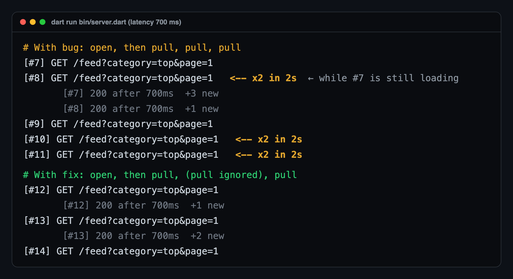
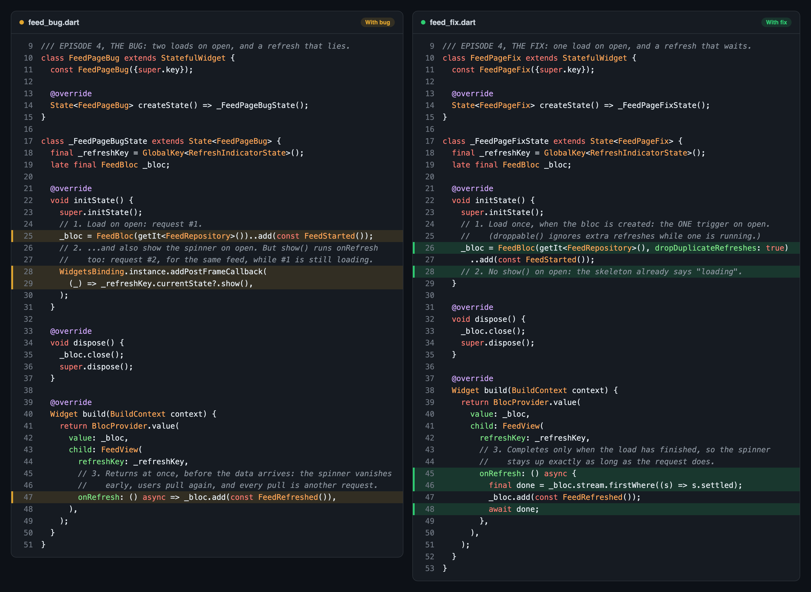
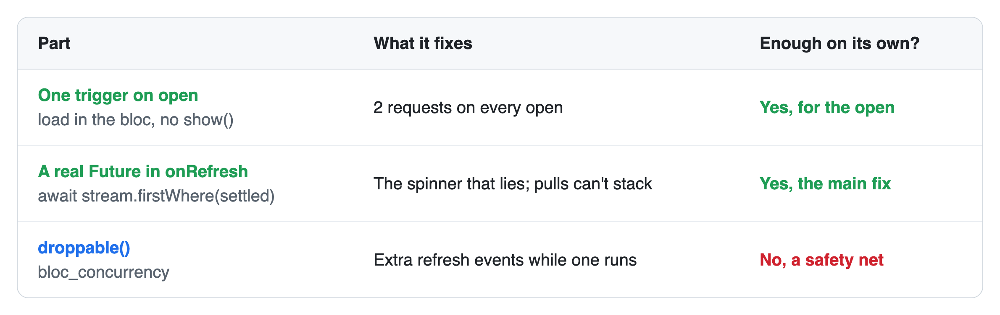
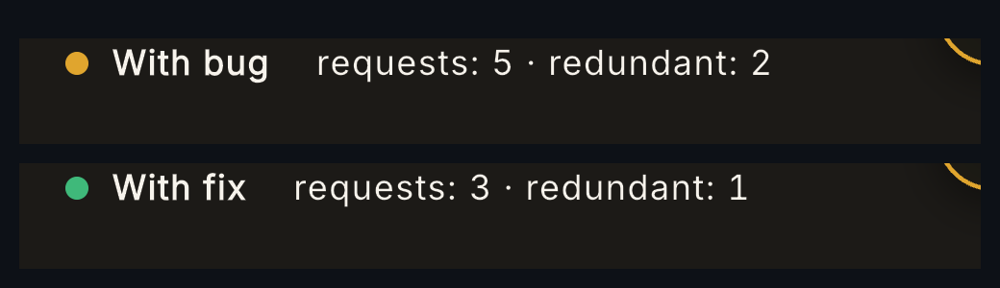

# Your pull-to-refresh is lying to your users

*Episode 4 of a series on finding wasted work in Flutter apps, with numbers instead of guesses.*


I built a small news reader called Brief: serif headlines, a warm paper theme, pull to
refresh. It looks finished. Then I watched my server log while opening it.

One open. Two identical requests.

Then I pulled to refresh, three times, because the spinner disappeared so fast I wasn't sure
it had worked. Five requests in total, three of them flagged by the server as duplicates.

This pattern is in almost every app I've reviewed. It's made of two perfectly reasonable
ideas that don't know about each other.



---

## Bug 1: two loads every time the screen opens

The feed loads in `initState`. That's idea one.

Idea two: "users should see a spinner while it loads," so the screen calls `show()` on its
`RefreshIndicator` right after the first frame.

```dart
@override
void initState() {
  super.initState();
  // 1. Load on open: request #1.
  _bloc = FeedBloc(getIt<FeedRepository>())..add(const FeedStarted());
  // 2. ...and also show the spinner on open.
  WidgetsBinding.instance.addPostFrameCallback(
    (_) => _refreshKey.currentState?.show(),
  );
}
```

Here's the catch: `RefreshIndicator.show()` doesn't just *draw* the spinner. It runs the same
`onRefresh` callback a pull would. So the screen loads the feed, and a moment later loads it
again, while the first request is still in flight.

In Brief you can even see it: the second response contains stories the first didn't, so a
"1 new story" pill appears the instant the app opens.

## Bug 2: the spinner that lies

```dart
onRefresh: () async => _bloc.add(const FeedRefreshed()),
```

`RefreshIndicator` keeps spinning until the `Future` returned by `onRefresh` completes. And
`bloc.add()` returns immediately. So this `Future` completes immediately, and the spinner
disappears long before the 700 ms response arrives.

From the user's side, nothing happened. So they pull again. And again. Every pull is another
request. With concurrent event handlers, the responses can even arrive out of order.


---

## The fix: three small changes



**1. One trigger on open.** The bloc loads once, when it's created. And `droppable()` from
`bloc_concurrency` ignores extra refresh events while one is running.

```dart
_bloc = FeedBloc(getIt<FeedRepository>(), dropDuplicateRefreshes: true)
  ..add(const FeedStarted());
```

**2. No `show()` on open.** The shimmer skeleton already says "loading". A second loading
indicator added nothing except a second request.

**3. An `onRefresh` that tells the truth.** Return a `Future` that completes when the data has
actually arrived:

```dart
onRefresh: () async {
  final done = _bloc.stream.firstWhere((s) => s.settled);
  _bloc.add(const FeedRefreshed());
  await done;
},
```

Now the spinner stays up exactly as long as the request does. And while it's up,
`RefreshIndicator` itself refuses another pull, so pulls can't stack.



I typed this fix into the running app and hot restarted (a hot *reload* wouldn't do it:
`initState` has to run again). The next open sent one request.

---

## The numbers

Brief has a small **Lab** sheet that switches the feed between the buggy and the fixed
version, so both run against the same server, back to back.


Open the feed once, then pull to refresh three times as fast as the indicator allows. Same
server, same 700 ms latency.


The debug strip in the app counts `/feed` requests with
[waste_lens_dio](https://pub.dev/packages/waste_lens_dio)'s `RedundantCallInterceptor`:



One honest footnote about "redundant". waste_lens_dio flags a request when an identical one
has *finished* within the last 2 seconds. That means:

- It **can't** see the two overlapping requests on open: neither has finished when the other
  starts. The server log catches those.
- The fix's `redundant: 1` is a real pull that started within 2 s of the previous load
  finishing. A time window can't tell a duplicate from a user who genuinely wants fresh news.

That's why the server log is the headline number here: **3 duplicates with the bug, 0 with the
fix**.

---

## Three questions you'll probably ask

**Why not just disable the indicator while loading?**
`RefreshIndicator` already refuses new pulls while its `Future` is pending. The bug isn't that
it allowed the pull; it's that we told it the refresh finished after 0 ms. Return the real
Future and it handles the rest.

**Isn't `droppable()` enough on its own?**
No. It only drops events that arrive *while a handler is still running*. With the lying
`onRefresh`, the user pulls again after the spinner is gone, often after the previous load has
finished, so nothing gets dropped. And it does nothing about the `show()`-on-open duplicate.
Keep it as a safety net.

**What about FutureBuilder?**
Same trap, different shape. `FutureBuilder(future: repo.load())` inside `build()` starts a new
request on every rebuild, and `onRefresh: () async => setState(...)` lies just the same. Create
the Future once, keep it in state, and return that same Future from `onRefresh`.

---

## The rule

**One trigger on open, and an `onRefresh` that tells the truth.** `droppable()` is a good
safety net, but the real fix is making the spinner mean what it says.

Watch the 2½-minute live-coding video: the duplicate in the server log, the spinner that lies,
and the fix typed in and hot restarted.

---

*Code: [github.com/poojadev/brief](https://github.com/poojadev/brief) · waste_lens:
[pub.dev/packages/waste_lens](https://pub.dev/packages/waste_lens) · waste_lens_dio:
[pub.dev/packages/waste_lens_dio](https://pub.dev/packages/waste_lens_dio)*

*Next episode: the stream you forgot to cancel.*
